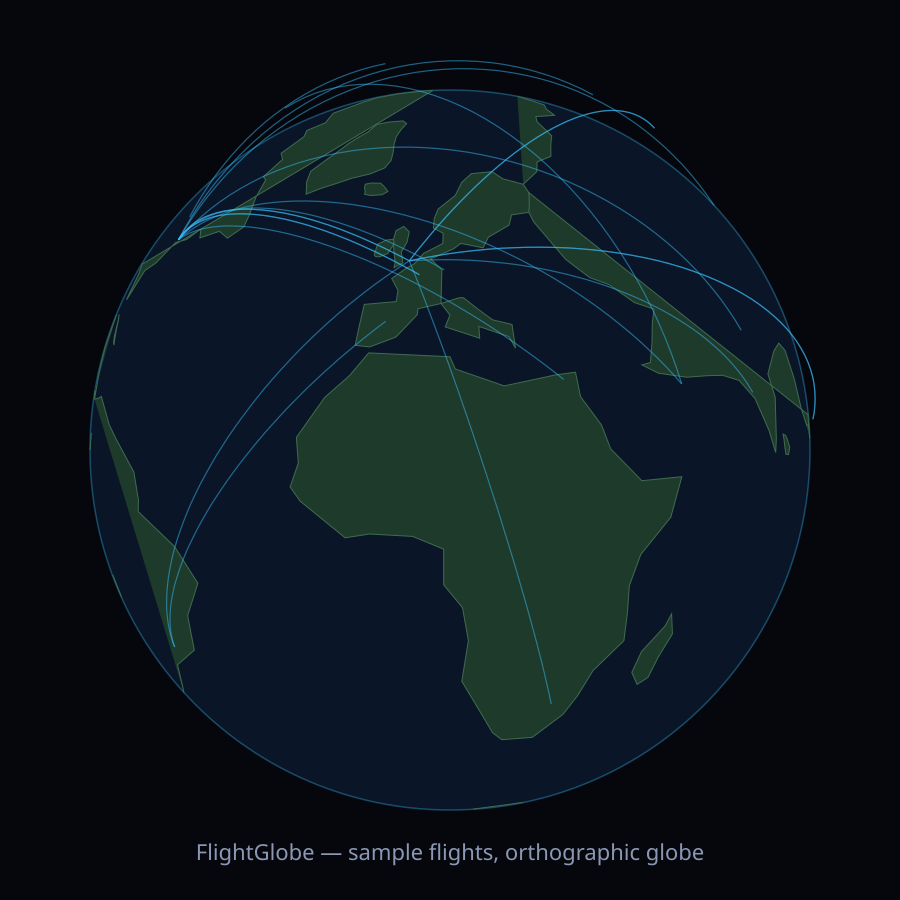

# FlightGlobe


**One screen. The whole planet, moving.**



FlightGlobe is a real-time world globe web app: an interactive orthographic
globe (drag to spin, scroll to zoom) with toggleable layers for **flights**,
**earthquakes** and **satellites**, plus a **time scrubber** that moves planes
along their great-circle arcs and sweeps the day/night terminator across the
planet. Click any plane to follow it — the camera locks on and rides along.

Pure vanilla JavaScript + canvas. **Zero dependencies, zero build step, zero
API keys.** It runs fully offline on bundled sample data, and optionally
pulls live data from free public APIs when the network is available.

## What it does

- **Globe** — orthographic projection on canvas, drag-to-rotate, zoom, and a
  bundled simplified world coastline dataset (`data/land.json`, 14 polygons).
  No map tiles are fetched at runtime.
- **Flights layer** — great-circle arcs between 50 airports, 67 sample
  flights, moving plane markers, airport dots. Click a plane (or a row in the
  sidebar list) for route, distance, duration and aircraft.
- **Earthquakes layer** — 40 sample quakes, markers sized and coloured by
  magnitude, strongest-quake stat in the sidebar.
- **Satellites layer** — 16 satellites (ISS, Starlink, NOAA-20, Hubble,
  Tiangong, GPS, GOES-16…) on orbit rings with moving dots.
- **Time scrubber (the twist)** — drag the 24-hour timeline and watch flights
  move along their arcs while the day/night terminator sweeps the globe.
  Play/pause, 1×–120× speed, "Now" jumps to the real UTC time.
- **Follow a flight** — locks the camera onto one plane as it flies.
- **Airport search** — type a code, city or name; clicking a result centres
  the globe on that airport.
- **Flight search** — find a flight by id (SQ318, BA117…) and jump to it.
- **Departures board** — the next flights out after the scrubbed time.
- **Measure tool** — click two points on the globe for the great-circle
  distance between them.
- **Flat-map mode** — the same layers on an equirectangular map (F key).
- **Keyboard shortcuts** — arrows rotate, +/− zoom, Space plays/pauses,
  F flat map, R reset view, ? opens the shortcut panel.
- **Export PNG** — download the current globe view as an image.
- **Layer stats** — flights airborne now, longest route in the air, strongest
  quake, satellites tracked.
- **Day/night shading** — the terminator is computed from the real solar
  position for the scrubbed time.

## Run it

```bash
# any static server works — the app is pure static files
npm start          # serves http://localhost:8080
# or
npx serve .
# or
python3 -m http.server 8080
```

Then open <http://localhost:8080>. No build step, no install step.

## Tests & checks

```bash
npm test            # 88 unit tests (node:test, no dependencies)
npm run build       # build check: all files present, JS parses, JSON valid
npm run validate-data  # validates every bundled dataset
```

## Data sources

| Layer | Bundled (offline) | Live (optional, best-effort) |
| --- | --- | --- |
| Flights | 49 invented sample schedules between 40 real airports | [OpenSky Network](https://opensky-network.org/) states API — no key |
| Earthquakes | 30 sample quakes near real seismic zones | [USGS](https://earthquake.usgs.gov/) past-day M2.5+ feed — no key |
| Satellites | 12 satellites, circular-orbit parameters | — (bundled only; labelled as sample) |
| Coastline | Hand-drawn simplified outlines (14 polygons) | — |

Live fetching never blocks the app: any failure falls back silently to the
bundled data and the header badge says which source is active. Nothing is
ever committed with a key — there are no keys at all.

## Project layout

```
index.html            one screen: globe canvas + sidebar + timeline
css/                  base, globe, panel, controls, responsive
js/
  math.js             orthographic projection (lat/lon <-> screen)
  geo.js              great-circle distance, bearing, arc interpolation
  time.js             scrubber math, subsolar point, terminator
  data.js             dataset loading + validation
  live.js             OpenSky / USGS fetching with graceful fallback
  flights.js          flight model (position at a given time)
  quakes.js           magnitude -> size / colour / severity
  satellites.js       circular-orbit positions + rings
  render.js           globe disc, land, graticule, night shading
  layers.js           arcs, planes, quake + satellite drawing, hit-testing
  ui.js               sidebar: search, lists, detail panel, stats
  app.js              bootstrap, animation loop, drag/zoom, follow mode
data/                 airports, flights, earthquakes, satellites, land (JSON)
scripts/              generate-data.py, serve.mjs, build-check.mjs, validate-data.mjs
tests/                node:test suites for every module above
```

## The twist, in one line

Drag the timeline: the sun moves, the night sweeps across the map, and every
plane slides along its arc — the whole planet as a clock you can spin.

## License

MIT. See [LICENSE](LICENSE).
